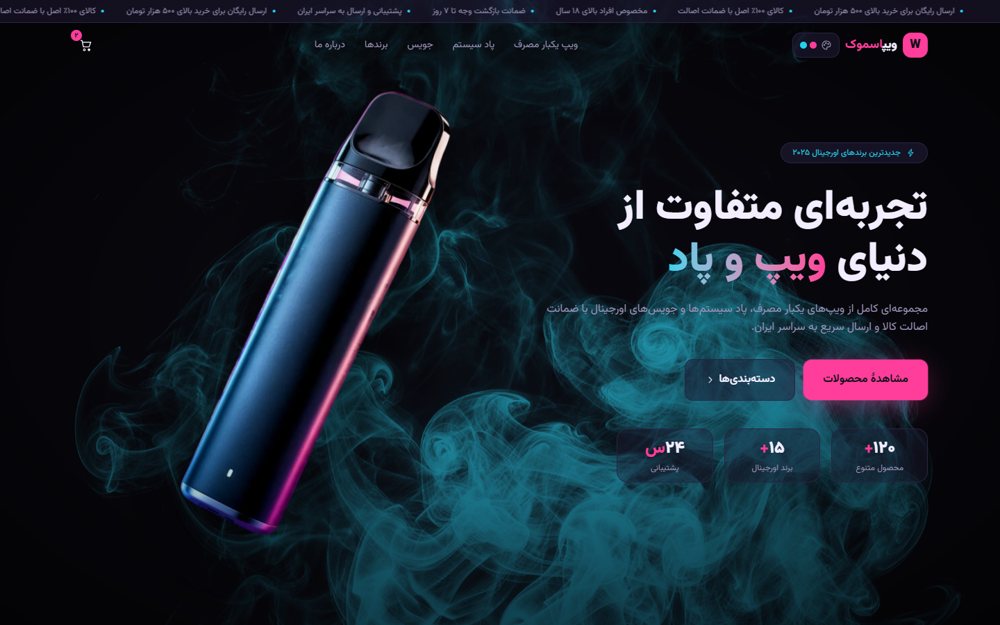
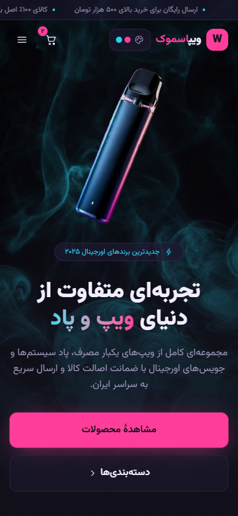

# SmokeShop / ویپ اسموک

A Persian, right-to-left storefront frontend exploring responsive layout,
scroll animation and theme switching with Next.js and TypeScript.



**Status:** frontend prototype with placeholder catalog, prices, testimonials and
store claims from [local data](src/lib/data.ts). Cart buttons and the newsletter
form are presentation controls: there is no checkout, payment processing,
subscription service or catalog backend in this checkout. A commercial launch
and live deployment have not been verified.

این مخزن نمونهٔ رابط فارسی و راست‌به‌چپ فروشگاه است. اطلاعات محصولات و ادعاهای
فروشگاه نمایشی‌اند؛ سبد خرید، پرداخت و خبرنامه به سرویس واقعی متصل نیستند.

## Responsive behavior

- At desktop widths (1024px and above), the sticky hero uses Motion scroll
  progress to cross-fade smoke layers and move the product image. Lenis runs
  only on desktop when reduced motion is off.
- Below 1024px, the hero uses four viewport-height snap anchors and an
  IntersectionObserver to change panels. Transitions happen between steps
  rather than continuously following scroll progress.
- With reduced motion enabled, the hero becomes a single static composition
  and Lenis is disabled. The breakpoint/preference hooks use a stable server
  snapshot to keep hydration consistent.
- Four dark palettes use CSS variables. Theme changes apply immediately;
  saving the selection is best-effort when browser storage is available.

See [hero selection](src/components/hero/HeroSection.tsx),
[mobile steps](src/components/hero/HeroStepStage.tsx),
[desktop composition](src/components/hero/HeroScrollStage.tsx) and
[scroll lifecycle](src/components/SmoothScroll.tsx). The smoke uses multiply
inside each layer and screen blending against a dark stage; the product sits
above those layers so the color treatment does not recolor it.



## Run locally

Verified with Node.js 24.11.1 and npm 11.6.2 on Windows. The lockfile pins Next.js
16.2.10, React 19.2.4, Motion, Lenis, Tailwind CSS 4 and the self-hosted Vazirmatn
font. No environment variables or external services are required for this preview.

```sh
git clone https://github.com/boyInShadows/smokeShop.git
cd smokeShop
npm ci
npm run dev
```

Open <http://localhost:3000>. For a local production preview:

```sh
npm run lint
npx tsc --noEmit
npm run build
npm start
```

## Verification and limits

On 2026-10-30, a clean locked install, lint, TypeScript check and production build
passed. Edge checks covered desktop, emulated mobile and reduced-motion hero
selection, RTL/no horizontal overflow, age-gate dismissal/persistence and mobile
menu toggling. These screenshots show the running production build with its
placeholder content. Physical-device smoothness and a complete accessibility
audit were not verified. There is no repository test script or quality CI.

The age screen is a prototype using a fixed Persian-year baseline of 1403 and
unguarded browser storage; it is not verified age enforcement and can fail when
storage is blocked. Some footer links are placeholders. A dated npm audit found
10 dependency advisories (1 critical, 8 high, 1 moderate); no bulk upgrade was
performed. No license is assigned by this documentation change; existing asset
and dependency rights still apply.
